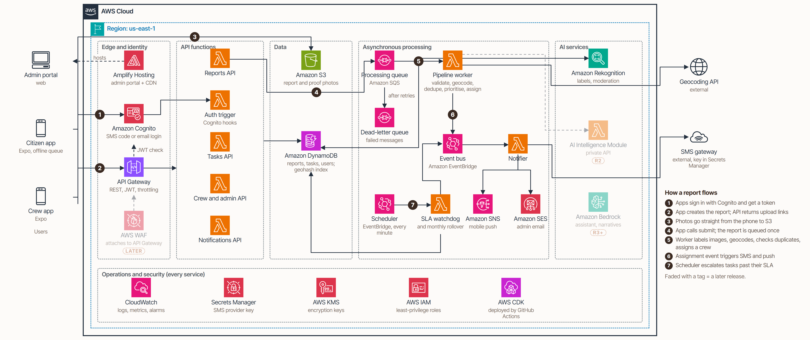

# CleanLoop

CleanLoop is a waste-reporting platform for Cameroonian cities. Citizens photograph
illegal dumping or overflowing bins. The platform locates the report, checks it against
nearby reports, sets a priority and assigns a collection crew. Everyone sees the report
move from submitted to resolved.



## What is in this repository

| Folder             | What it is                                              | Stack                                                                   |
| ------------------ | ------------------------------------------------------- | ----------------------------------------------------------------------- |
| `Backend/`         | AWS infrastructure and API functions                    | AWS CDK v2, TypeScript, Lambda, API Gateway, Cognito, DynamoDB, S3, SES |
| `Frontend/mobile/` | Citizen and crew app, with a guest mode                 | Expo (React Native), Expo Router, Zustand                               |
| `Frontend/web/`    | Admin portal: reports, tasks, crews and a map           | React, Vite, Tailwind CSS, React Leaflet                                |
| `Docs/`            | Requirements, diagrams, decision records, meeting notes |                                                                         |

The folders will be renamed to lowercase (`backend/`, `frontend/`, `docs/`) in one
Sprint 0 pull request, as set out in [CONTRIBUTING.md](CONTRIBUTING.md).

## Status

Release 1 (the core reporting loop) is being built in two-week Scrum sprints and
tracked in Jira (project key `CL`). The requirements live in the Agile SRS, with the
older detailed SRS in [Docs/srs](Docs/srs). Release 2 adds the AI Intelligence Module
for image analysis; later releases add insight dashboards and an assistant.

Known gaps in the current code, scheduled as Sprint 0 and Sprint 1 work:

- `GET /reports/presigned-upload` is public and must require sign-in or a device token.
- The SLA check runs every 5 minutes; the requirement is assignment within 60 seconds.
- Sign-in is email and password only; SMS code sign-in becomes the default, with email
  and password kept as an option.
- There is no lint, formatting or test setup and no CI pipeline yet.

## Getting started

### Prerequisites

- Node.js 20 or newer, and npm (each project keeps its `package-lock.json`)
- For the backend: an AWS account, the AWS CLI signed in, and a one-off
  `npx cdk bootstrap` in `us-east-1`
- For the mobile app: Expo Go on a phone, or an Android or iOS simulator

### Backend

```powershell
cd Backend
npm install
npx cdk deploy --all --context stage=dev --outputs-file cdk-outputs.json
```

This deploys five stacks, each named `CleanLoop-<Stack>-<stage>`: Storage, Auth,
Notifications, Compute and Api. `cdk-outputs.json` then holds the API URL and Cognito
IDs the apps need. It is git-ignored because it names your account; never commit it.

The CDK app reads these from `Backend/.env` (also git-ignored):

| Variable                                               | Purpose                                                             |
| ------------------------------------------------------ | ------------------------------------------------------------------- |
| `STAGE`                                                | `dev`, `staging` or `prod` (default `dev`; `--context stage=` wins) |
| `AWS_ACCOUNT`, `AWS_REGION`                            | Target account and region (default region `us-east-1`)              |
| `SES_FROM_EMAIL`                                       | Verified SES sender for reminder and notification emails            |
| `GOOGLE_MAPS_API_KEY`                                  | Geocoding for report locations and crew distances                   |
| `GOOGLE_OAUTH_CLIENT_ID`, `GOOGLE_OAUTH_CLIENT_SECRET` | Optional Google sign-in through Cognito                             |
| `MAX_AUTO_ASSIGN_DISTANCE_KM`                          | Furthest crew distance for automatic assignment                     |

### Mobile app

```powershell
cd Frontend/mobile
npm install
npx expo start
```

Create `Frontend/mobile/.env` with the values from `cdk-outputs.json`:

```
EXPO_PUBLIC_API_URL=
EXPO_PUBLIC_COGNITO_REGION=us-east-1
EXPO_PUBLIC_COGNITO_CLIENT_ID=
EXPO_PUBLIC_COGNITO_DOMAIN=
```

### Admin portal

```powershell
cd Frontend/web
npm install
npm run dev
```

Create `Frontend/web/.env` with:

```
VITE_API_URL=
VITE_COGNITO_REGION=us-east-1
VITE_COGNITO_CLIENT_ID=
```

## Documentation

- [Use case diagram](Docs/diagrams/use-case-diagram-v3.png),
  [report submission](Docs/diagrams/report-submission-activity-v3.png) and
  [image analysis](Docs/diagrams/image-analysis-activity-v3.png) activity diagrams.
  Their generator scripts are in [Docs/diagrams/src](Docs/diagrams/src).
- Architecture decisions: [Docs/adr](Docs/adr)
- Sprint reviews and retrospectives: [Docs/meetings](Docs/meetings)

## Contributing

Read [CONTRIBUTING.md](CONTRIBUTING.md) before your first pull request. In short: one
branch per Jira story (`feat/CL-12-duplicate-check`), commits written as
`type(scope): what changed (CL-12)`, and every change reaches `main` through a reviewed
pull request.

## Team

| Role          | Name    |
| ------------- | ------- |
| Product Owner | Mathias |
| Scrum Master  | Bryan   |
| AI lead       | Imele   |
