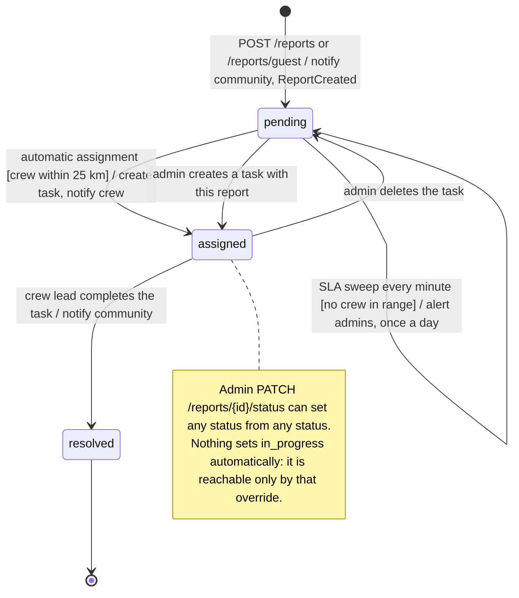
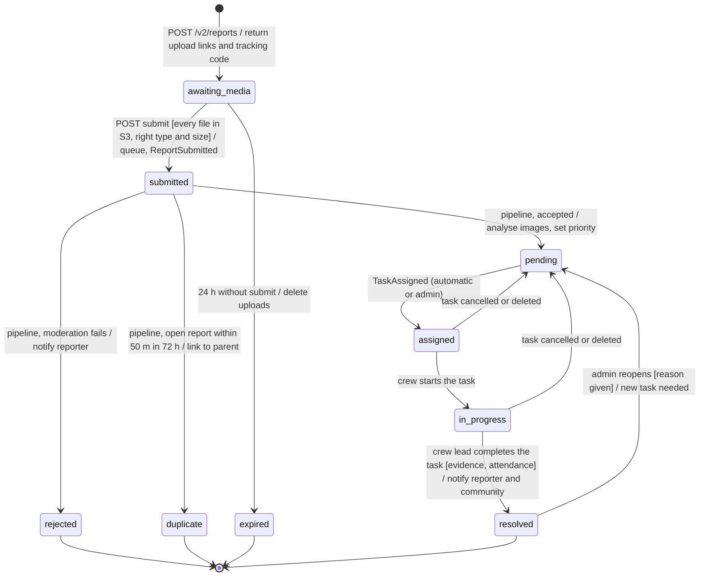
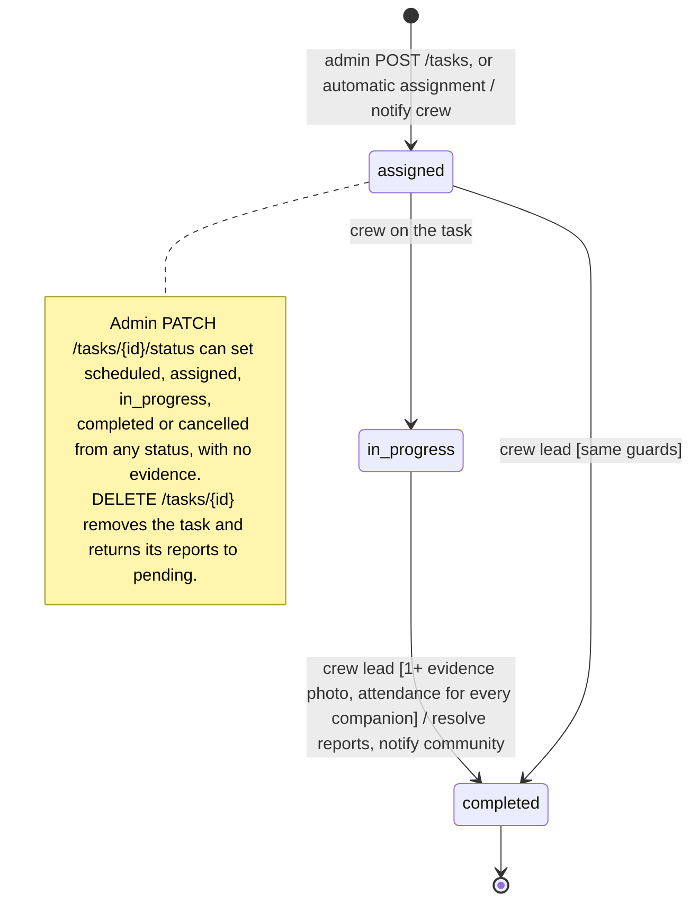
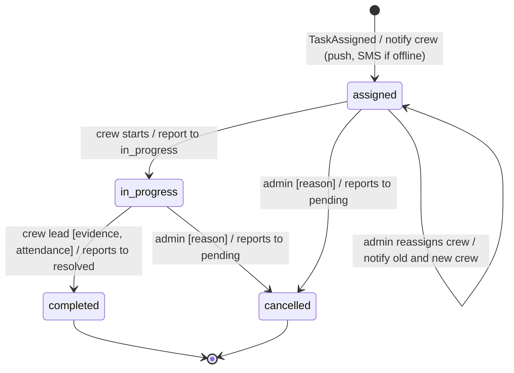

# Report and task state machines

UML state machines for the two lifecycles, as the code behaves today and as the new
report flow needs them. GitHub renders the diagrams. Transition labels read
`trigger [guard] / effect`.

## Report

### Today

Problems this shows:

- `in_progress` is never set when the crew starts the task, so citizens see `assigned`
  until the report is resolved.
- The admin override skips every rule, including moving a resolved report back to
  pending without touching its task.
- Cancelling a task (`status = cancelled`) leaves its reports `assigned` forever. Only
  deleting the task returns them to `pending`.

### Target (new report flow)

Rules:

- `submitted` lasts while the processing pipeline runs (moderation, geocoding, duplicate
  check, image analysis). The parent report's priority rises once it has 3 duplicates.
- Only the rows above are allowed. The status endpoint rejects anything else with 409,
  so the admin override becomes "reopen" and "reject" with a reason, not a free choice.
- Report status follows its task: the task service changes the report in the same
  transaction as the task.
- A duplicate keeps its own record and points at the parent with `parentReportId`; its
  reporter is notified when the parent is resolved.
- Every change appends `{status, at, by}` to the report's history, which feeds the public
  tracking page.

## Task

### Today

Problems this shows:

- Nothing creates a `scheduled` task, but the daily reminder looks only for `scheduled`
  and `in_progress` tasks, so tasks in `assigned` (all of them, at first) never get a
  reminder.
- An admin can complete a task without evidence, which resolves its reports.
- `cancelled` does not release the reports (see Report, today).

### Target

Rules:

- `scheduled` is dropped: `scheduledAt` already says when work is planned, and the
  reminder uses `dueAt`.
- Overdue is a flag, not a state: the SLA watchdog sets `overdueAt` on active tasks past
  `dueAt` and alerts admins once.
- Admins complete a task only through the same evidence rules, or cancel it.
- Deleting a task is kept for mistakes made within a few minutes; afterwards, cancel.
