# SRS figures: AI module (Release 2)

Figures 7 to 10, 12 to 15 and 19 to 24 of the SRS, for the AI Intelligence Module (AIM).
Figure 2, the AI architecture, is a slide in the project deck; figure 6, image analysis,
is `image-analysis-activity-v3.png` in this folder.

These follow the SRS as written. Two decisions are still open and will change some of
them: the vision model (Imele's Nova Lite benchmark against Rekognition) and the
recommendation mode switch (D-03). Throughout, the core keeps authority: the AIM
recommends, the backend decides, and the AIM never reads core tables directly.

Activity diagrams draw each swimlane as a box; flowcharts use orthogonal lines.

## Figure 7: AI chatbot activity diagram

One assistant turn, including language detection, role check, retrieval, tool calls,
guardrails and the safe fallback.

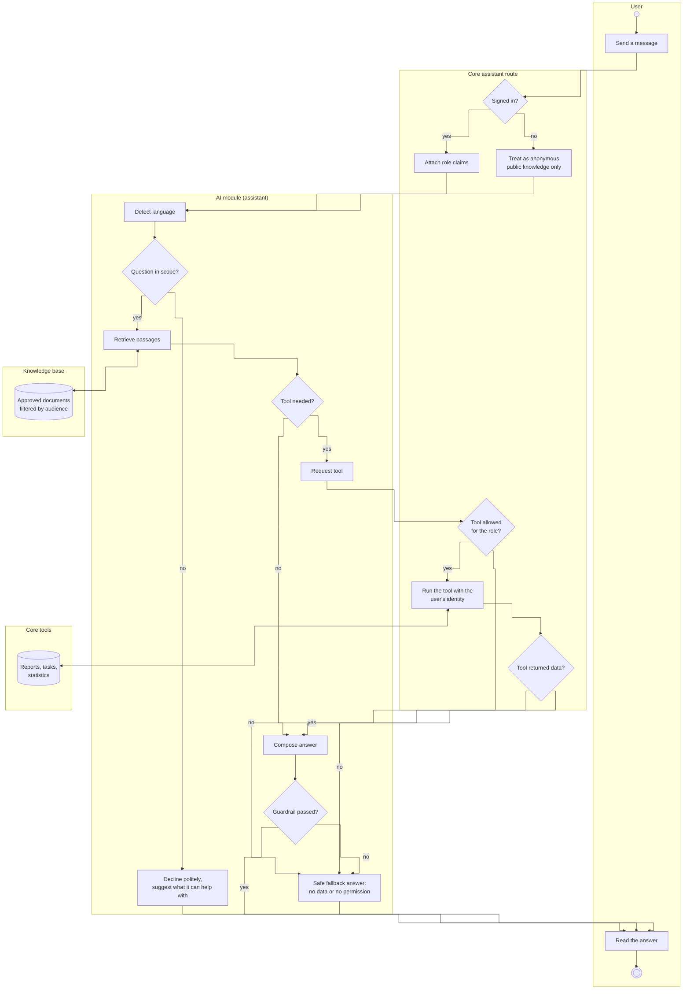

## Figure 8: AI analytics generation activity diagram

From a schedule or a request to an approved, verified report. Numbers come from queries;
words come from the model.

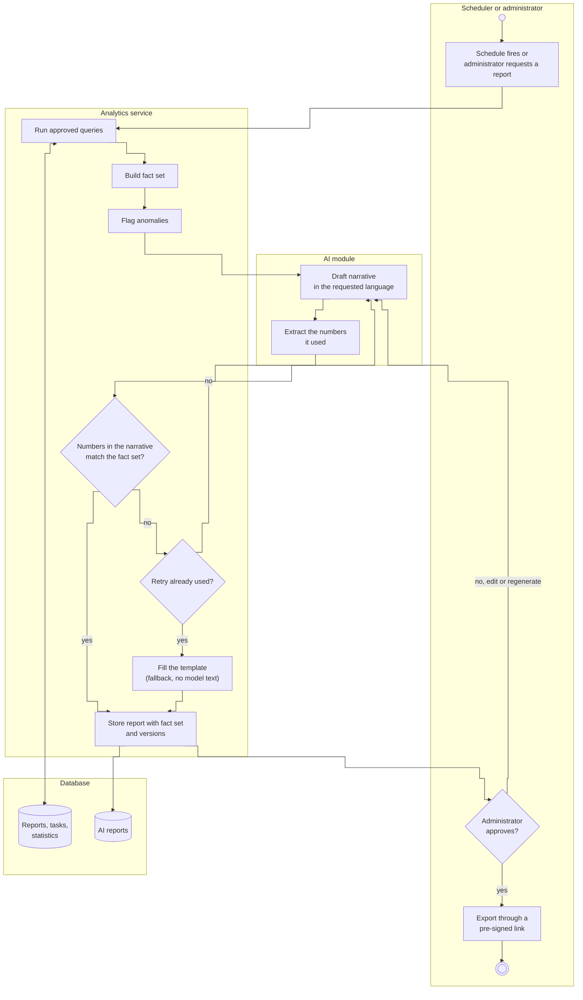

## Figure 9: pollution hotspot detection activity diagram

How report records become classified hotspots.

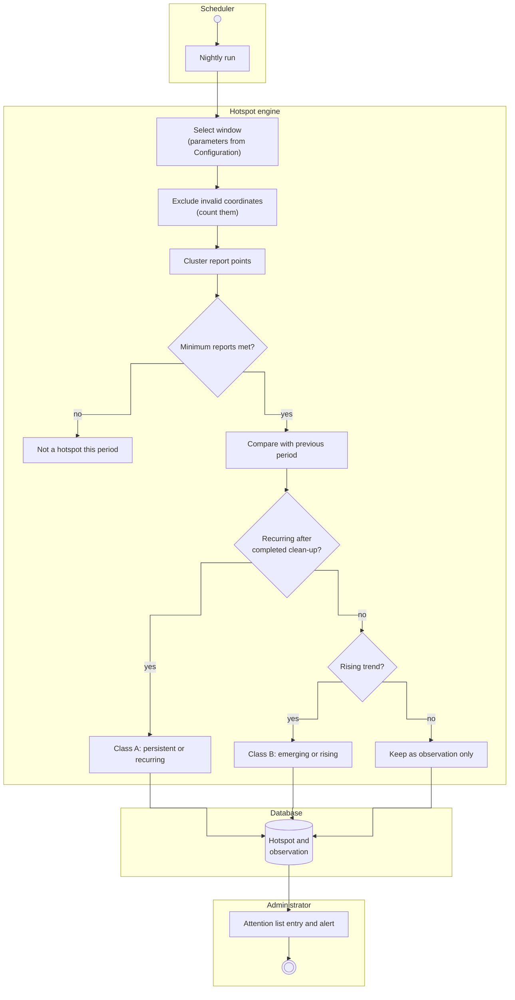

Class C is not produced.

## Figure 10: crew and vehicle recommendation activity diagram

Constraint filtering, scoring and the administrator's decision. Only the Tasks service
applies the final assignment.

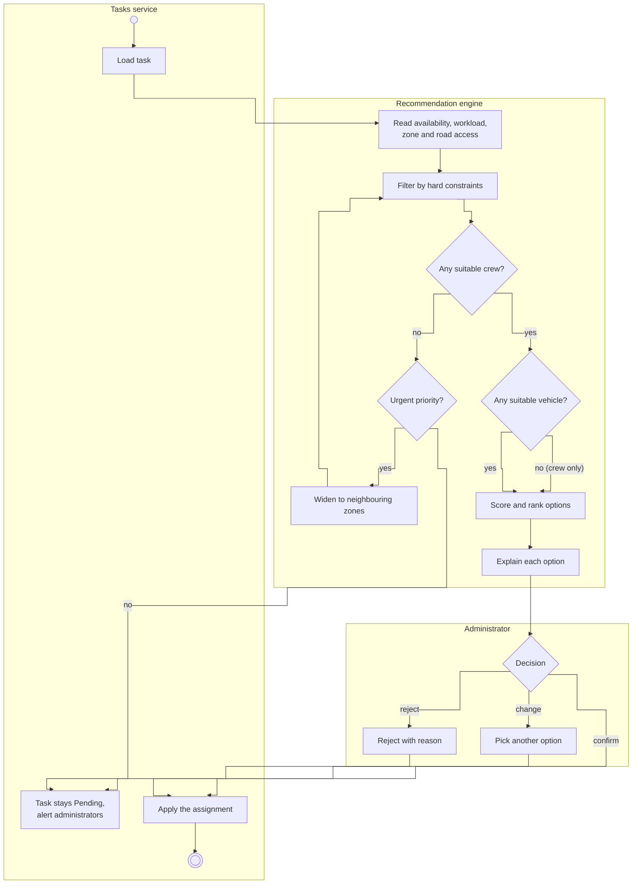

## Figure 12: AI chatbot interaction sequence diagram

One chat turn with a tool call and a permission check. The reply language travels with
every message.

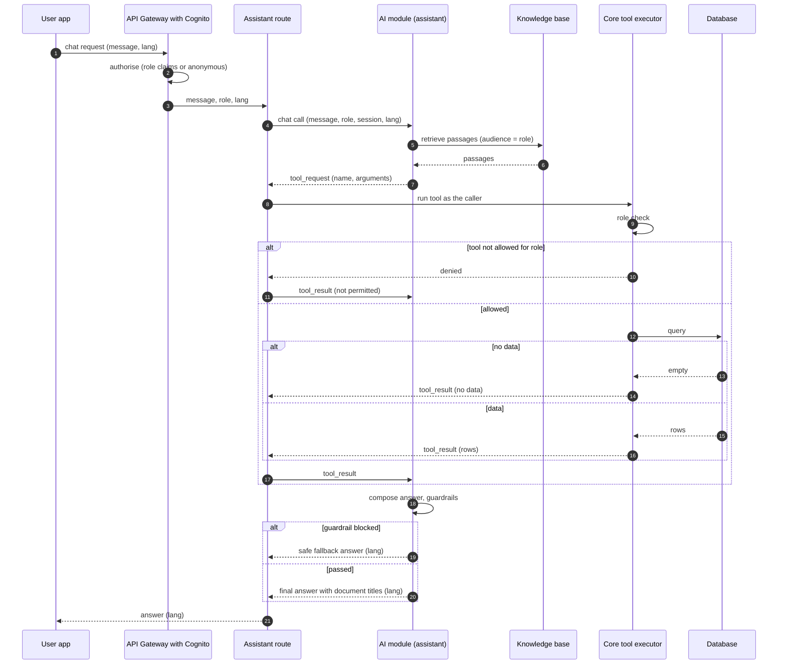

## Figure 13: administrator analytics request sequence diagram

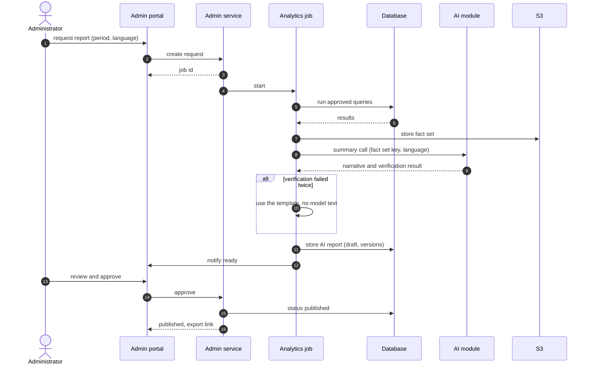

## Figure 14: pollution hotspot processing sequence diagram

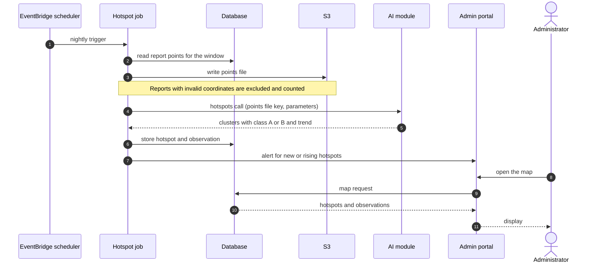

## Figure 15: crew and vehicle recommendation and assignment sequence diagram

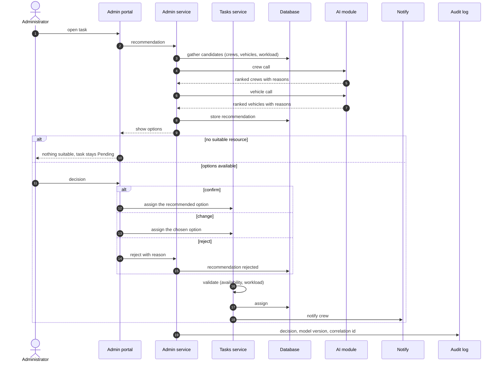

## Figure 19: AI data processing and integration flow

What the core sends to each module, what the module stores or reads, and what comes
back. The AIM does not read core tables.

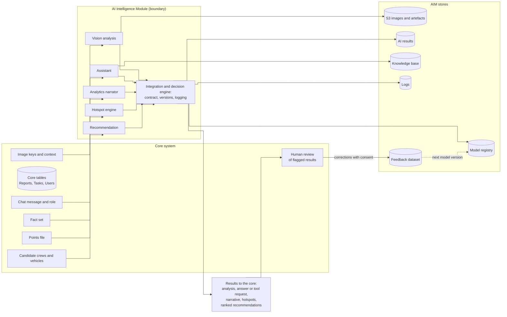

The invisible link only keeps the core tables beside the boundary: no arrow crosses from
the AIM into them.

## Figure 20: waste image analysis workflow

The operational path of a report's images, naming components, queues and stores
(the decision logic is figure 6).

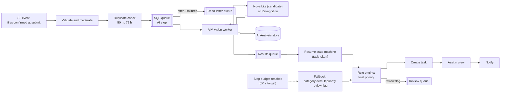

## Figure 21: AI chatbot and knowledge retrieval workflow

Knowledge preparation and the runtime path of a chat turn (the decision logic is
figure 7).

```mermaid
%%{init: {"flowchart": {"curve": "step"}}}%%
flowchart TB
  subgraph Prep["Knowledge preparation"]
    direction LR
    doc["Document approved<br/>by an administrator"] --> tag["Tag audience:<br/>public, citizen, crew, admin"]
    tag --> chunk["Chunk"] --> index["Index"] --> ver["Version"]
    ver --> kb[("Knowledge base")]
  end
  subgraph Run["Chat turn at runtime"]
    direction LR
    msg["User message"] --> lang["Detect language"] --> claims["Read role claims"]
    claims --> gin["Input guardrails"] --> ret["Retrieve, filtered<br/>by audience"]
    ret --> call["Model call"]
    call -- "tool request" --> exec["Core tool executor"]
    exec --> db[("Database")]
    exec --> call
    call --> gout["Output guardrails"] --> ans["Answer citing<br/>document titles"]
    ans --> sess[("Session store<br/>with time-to-live")]
  end
  kb --> ret
  ans -.->|unanswered questions| mon["Monitoring"]
  mon -.->|new or updated documents| doc
```

## Figure 22: AI-generated analytics workflow

Scheduled and on-demand analytics across components (the decision logic is figure 8).

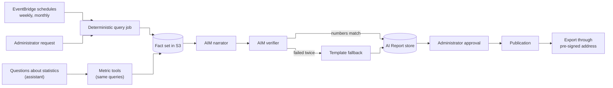

## Figure 23: pollution and waste hotspot intelligence workflow

From report coordinates to stored hotspots and where they are used (the decision logic
is figure 9).

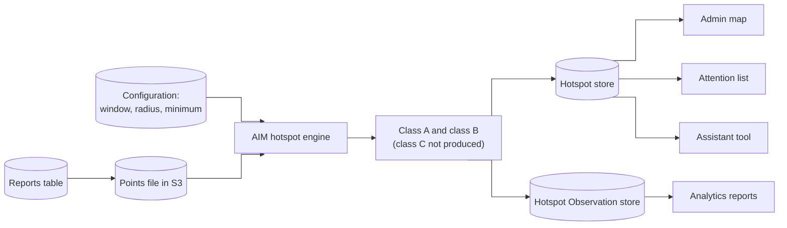

## Figure 24: intelligent crew and vehicle allocation workflow

How recommendations fit into assignment and approval, and where the backend keeps
authority (the decision logic is figure 10).

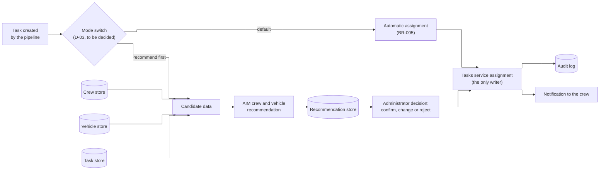
