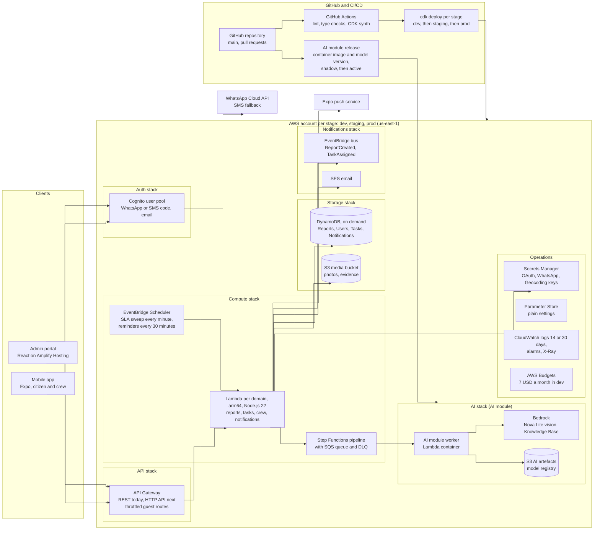
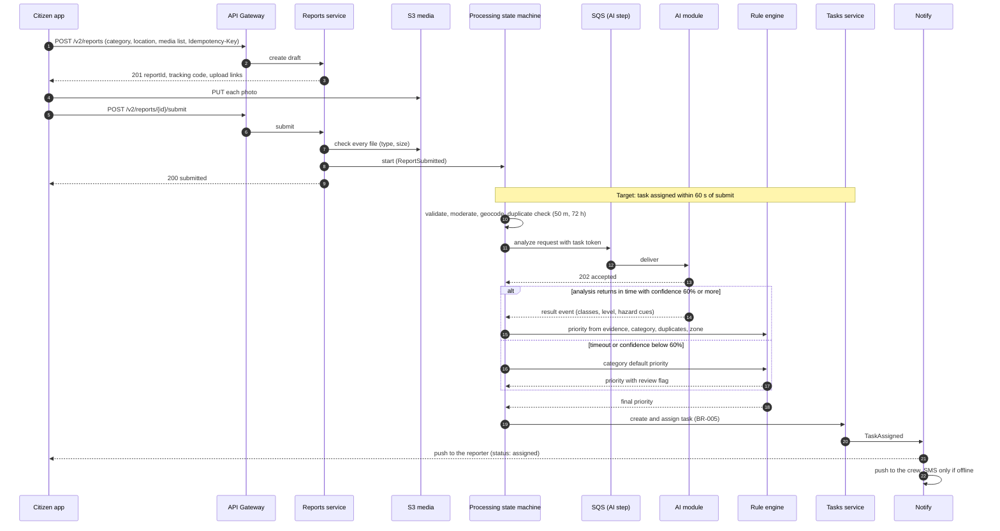
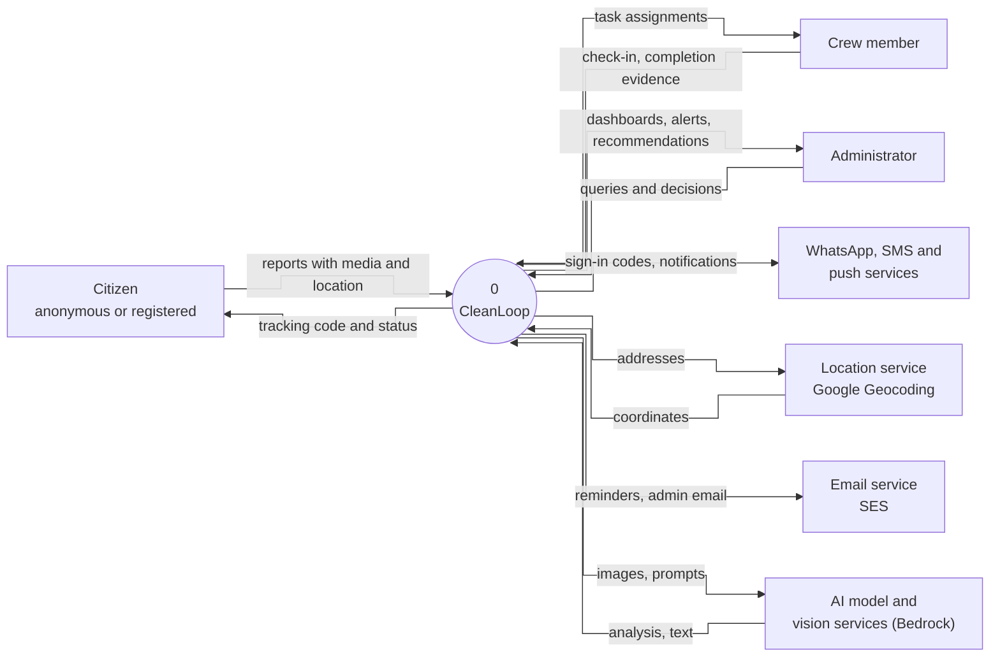
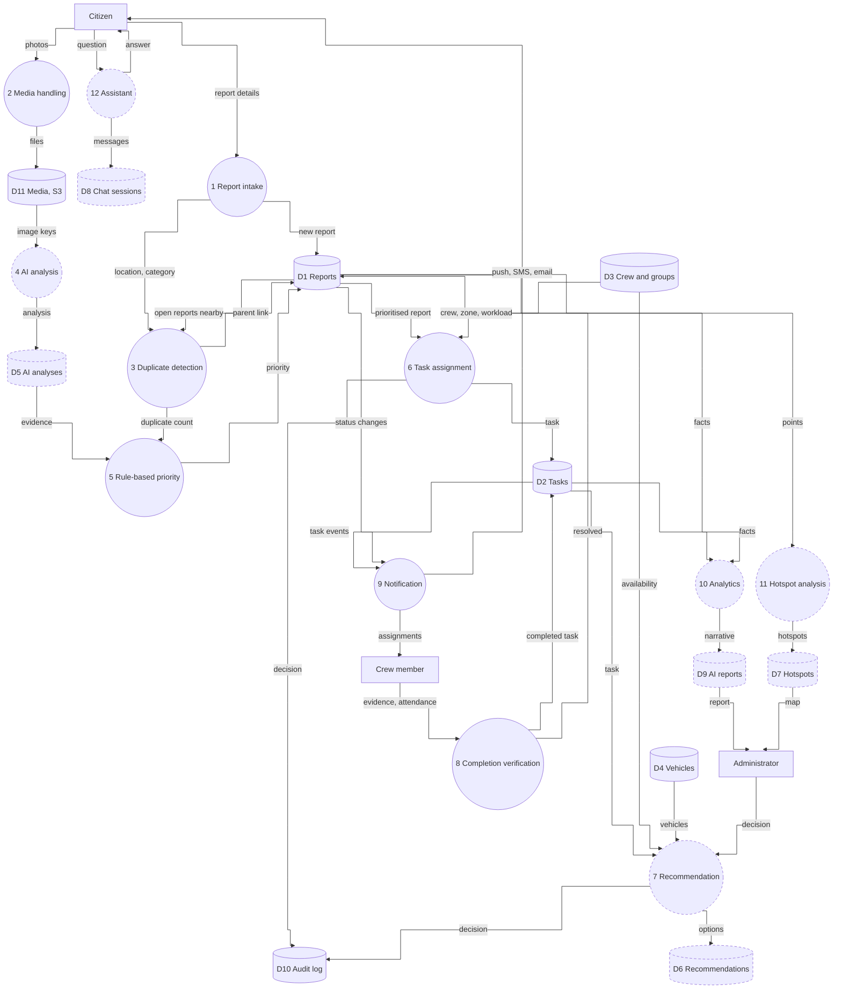

# SRS figures: Release 1

Figures 3, 11, 16, 17 and 18 of the SRS, drawn as Mermaid so GitHub renders them and
they can be edited as text. Figures 1, 4, 5 and 6 are the PNGs in this folder. The AI
module figures are in [ai-module.md](ai-module.md).

Where [ADR 0001](../adr/0001-backend-redesign.md) changed the SRS design (push before
SMS, Nova Lite instead of Rekognition, no WAF until it is needed), the figures follow the
ADR and say so. Flowcharts use orthogonal lines.

## Figure 3: AWS cloud deployment architecture

AWS services, stacks and environments used to run CleanLoop, and how the AI module is
released separately.

Notes:

- One AWS account per stage keeps dev data and spending apart from production; the
  budget alarm covers the whole account.
- Not in Release 1: CloudFront and WAF in front of the API (added if abuse appears),
  SageMaker endpoints (only if a custom model outgrows Bedrock), customer-managed KMS
  keys (a ready switch, see ADR 0001 section 7a).
- The Step Functions pipeline and AI stack arrive with the new report flow; today the
  reports Lambda assigns crews directly.

## Figure 11: citizen report submission and AI image analysis (sequence)

Message order from the citizen to an assigned task, including the asynchronous analysis
and its fallback. Uses the new report flow from `docs/api/openapi.yaml`.

## Figure 16: entity relationship diagram

All entities with keys and relationships. Mermaid ERDs have no colour legend, so new AI
entities carry `AI` in their name and modified entities list their added attributes
marked `added`.

```mermaid
erDiagram
  USER ||--o{ REPORT : submits
  ANONYMOUS_SESSION ||--o{ REPORT : "submits as guest"
  REPORT }o--o| REPORT : "duplicate of"
  REPORT }o--o| TASK : "handled by"
  ZONE ||--o{ REPORT : contains
  CREW_GROUP ||--o{ CREW_MEMBER : has
  ZONE ||--o{ CREW_GROUP : "operational zone"
  CREW_GROUP ||--o{ TASK : "assigned to"
  CREW_MEMBER ||--o{ TASK : leads
  TASK ||--o{ ATTENDANCE : records
  CREW_MEMBER ||--o{ ATTENDANCE : "marked in"
  USER ||--o{ NOTIFICATION : receives
  USER ||--o{ MARKETPLACE_LISTING : posts
  MARKETPLACE_LISTING ||--o{ MARKETPLACE_REQUEST : receives
  USER ||--o| LEADERBOARD_ENTRY : ranks
  CREW_MEMBER ||--o{ MONTHLY_STATISTICS : "summarised in"
  USER ||--o{ AUDIT_LOG : "acts in"
  REPORT ||--o| AI_ANALYSIS : "current analysis"
  AI_ANALYSIS ||--o{ AI_REVIEW : "reviewed by"
  AI_MODEL_VERSION ||--o{ AI_ANALYSIS : produces
  AI_MODEL_VERSION ||--o{ AI_RECOMMENDATION : produces
  TASK ||--o| AI_RECOMMENDATION : "active recommendation"
  TASK }o--o| VEHICLE : uses
  ZONE ||--o{ VEHICLE : "based in"
  AI_HOTSPOT ||--o{ AI_HOTSPOT_OBSERVATION : "observed as"
  AI_CHAT_SESSION ||--o{ AI_CHAT_MESSAGE : contains
  USER ||--o{ AI_REPORT : approves

  USER {
    string userId PK
    string email
    string phone
    string role "CITIZEN, CREW, ADMIN"
    string status
  }
  ANONYMOUS_SESSION {
    string sessionId PK
    string trackingCodes
  }
  REPORT {
    string reportId PK
    string trackingCode
    string type
    string status
    number lat
    number lng
    string zoneId FK
    string submittedBy FK
    string assignedTaskId FK
    string parentReportId FK
    string aiStatus "added"
    string aiAnalysisId "added"
    string prioritySource "added: rules or default"
    boolean reviewRequired "added"
  }
  TASK {
    string taskId PK
    string status
    string crewLeadId FK
    string crewGroupId FK
    datetime scheduledAt
    datetime dueAt
    string vehicleId "added"
    string recommendationId "added"
  }
  CREW_MEMBER {
    string userId PK
    string crewGroupId FK
    string availabilityStatus "added"
    string shift "added"
  }
  CREW_GROUP {
    string crewGroupId PK
    string operationalZoneId "added"
    number maxOpenTasks "added"
  }
  ATTENDANCE {
    string taskId PK
    string userId PK
    string arrival "on time, late, absent"
    datetime markedAt
  }
  NOTIFICATION {
    string notificationId PK
    string userId FK
    string type
    boolean read
  }
  MONTHLY_STATISTICS {
    string userId PK
    string month PK
  }
  MARKETPLACE_LISTING {
    string listingId PK
    string userId FK
  }
  MARKETPLACE_REQUEST {
    string requestId PK
    string listingId FK
  }
  LEADERBOARD_ENTRY {
    string userId PK
    number points
  }
  ZONE {
    string zoneId PK
    string roadAccessClass "added"
  }
  AUDIT_LOG {
    string auditId PK
    string actorId FK
    string modelVersionId "added"
    string correlationId "added"
  }
  CONFIGURATION {
    string key PK
    string value "added keys: AI switches, thresholds"
  }
  AI_ANALYSIS {
    string analysisId PK
    string reportId FK
    string modelVersionId FK
    string status
    string aggregateResult
    boolean reviewRequired
  }
  AI_MODEL_VERSION {
    string modelVersionId PK
    string kind
    string status "candidate, shadow, active, retired"
  }
  AI_REVIEW {
    string reviewId PK
    string analysisId FK
    string decision
    boolean consentForTraining
  }
  AI_RECOMMENDATION {
    string recommendationId PK
    string taskId FK
    string status "proposed, confirmed, changed, rejected"
    boolean noSuitable
  }
  VEHICLE {
    string vehicleId PK
    string zoneId FK
    string capacityClass
    string status
  }
  AI_HOTSPOT {
    string hotspotId PK
    string class "A or B"
    string centroid
    number radius
  }
  AI_HOTSPOT_OBSERVATION {
    string hotspotId PK
    string period PK
    number reportCount
    string trend
  }
  AI_CHAT_SESSION {
    string sessionId PK
    string role
    string language
    number ttl
  }
  AI_CHAT_MESSAGE {
    string sessionId PK
    number sequence PK
    string speaker
    string text "masked"
  }
  AI_REPORT {
    string aiReportId PK
    string period
    string status "draft, approved, published"
    string approvedBy FK
  }
```

Release 1 stores only User, Report, Task and Notification in DynamoDB today; the data
access plan is in [docs/api/access-patterns.md](../api/access-patterns.md).

## Figure 17: context-level data flow diagram (level 0)

CleanLoop as one process with its external entities.

## Figure 18: data flow diagram (level 1)

Main processes and data stores, including the AI processes (dashed).

